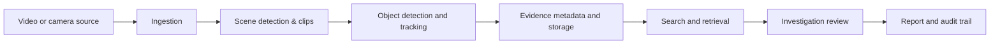

<!--
  Generative-Ai | Repository landing page
  Keep links relative where possible so this README works on GitHub.
-->

Generative-Ai
Learn it. Build it. Test it. Make AI useful.
A hands-on workspace for Generative AI, deep learning, computer vision, and applied AI systems — including course assignments, experiments, and an AI Forensic Investigation System.

  
  
  

  
  
  
  
  

🧭 Quick navigation
✨ Overview	🗂️ Projects	🧪 Learning	⚙️ Setup	🤝 Contribute

✨ What is this repository?
This repository documents a practical journey through AI: starting with core machine-learning ideas, moving into deep-learning experiments, and applying those ideas to real software projects.

Rather than being only a collection of notes, it brings together runnable notebooks, experiments, project documentation, and implementation work. Content evolves as assignments are completed and systems are improved.

🧠 Learn	🧪 Experiment	🏗️ Build
Understand models and concepts	Compare outputs and evaluate results	Apply AI concepts in practical systems
Generative and discriminative learning	Reconstruction, classification, and visualization	Video analysis and investigation assistance

🚀 Explore the repository
<table>
  <tr>
    <td width="50%" valign="top">
      <h3>🕵️ AI Forensic Investigation System</h3>
      An AI-assisted prototype for exploring CCTV/video evidence through a processing pipeline, detection and tracking, evidence indexing, and investigation-oriented tools.
        
      <strong>Project material</strong>
      <ul>
        <li><a href="AI%20Forensic%20Investigation%20System/Document/README.md">Technical documentation &amp; setup</a></li>
        <li><a href="AI%20Forensic%20Investigation%20System/Document/AI-Forensic-Investigation-Overview.pptx">Project overview presentation</a></li>
        <li><a href="AI%20Forensic%20Investigation%20System/Document/FINAL_SYSTEM_REPORT.md">Final system report</a></li>
        <li><a href="AI%20Forensic%20Investigation%20System/Document/PHASE9_REPORT.md">Phase 9 report</a></li>
      </ul>
      <a href="AI%20Forensic%20Investigation%20System/">Open project folder →</a>
    </td>
    <td width="50%" valign="top">
      <h3>📚 Deep Learning &amp; Generative AI Assignments</h3>
      Course assignments and Jupyter notebooks covering model concepts, implementation, visualization, and evaluation.
        
      <strong>Start here</strong>
      <ul>
        <li><a href="Assignment/MNIST(Assignment1).ipynb">Assignment 1 — MNIST: generative vs. discriminative models</a></li>
        <li><a href="Assignment/">Browse all assignments</a></li>
      </ul>
      <a href="Assignment/">Open coursework folder →</a>
    </td>
  </tr>
  <tr>
    <td width="50%" valign="top">
      <h3>🧩 Mini Assessment: Repository Explainer</h3>
      A local GenAI application that accepts a public GitHub repository URL and generates a structured explanation using a locally running LLM.
        
      <a href="Mini%20assessment/README.md">Read the setup guide →</a>
    </td>
    <td width="50%" valign="top">
      <h3>🛠️ Development Environment</h3>
      Repository configuration and development-container settings to support a repeatable workflow.
        
      <a href=".devcontainer/devcontainer.json">View Dev Container configuration →</a>
    </td>
  </tr>
</table>

🔬 Featured project: AI Forensic Investigation System
Purpose: help an investigator navigate video evidence more efficiently. The system is designed as an investigation aid, not as an autonomous decision-maker.

The project's documented components include a video-ingestion workflow, scene segmentation and clip extraction, object detection/tracking, data persistence, evidence-oriented retrieval, and investigation/reporting modules.
Conceptual workflow

Technology snapshot
Area	Technologies documented in the project
Frontend	Next.js, TypeScript
API/backend	Python, FastAPI, Pydantic
Relational data	PostgreSQL, SQLAlchemy, Alembic
Object storage	MinIO (S3-compatible)
Video & vision	FFmpeg, OpenCV, PySceneDetect, YOLO
Retrieval & agent workflows	Qdrant, retrieval-augmented generation (RAG), LangGraph
Live transport / processing	WebRTC, WebSockets, camera-source adapters
Local development	Docker, Docker Compose, pytest

Important scope note: individual capabilities have different verification states. Physical camera access and live model-provider credentials can depend on the machine and runtime environment. Check the [final system report](AI%20Forensic%20Investigation%20System/Document/FINAL_SYSTEM_REPORT.md) before treating a live hardware path as verified.
Responsible-use principles
- No facial recognition or biometric identity claims.
- Use tracking labels to follow visible objects across frames, not to identify real-world people.
- Keep original evidence distinct from derived clips, detections, and generated summaries.
- Treat AI-generated outputs as leads for human review, not as proof by themselves.
- Preserve traceability and avoid inventing timestamps or unsupported conclusions.
[Read the project documentation →](AI%20Forensic%20Investigation%20System/Document/README.md)
🧠 Learning roadmap
The repository supports a learning path from fundamentals to applied systems:
1. Understand the problem — identify what a model learns and what its output means.
2. Implement a baseline — start with a small, interpretable model.
3. Explore representations — work with neural networks, autoencoders, and latent spaces.
4. Evaluate thoughtfully — compare predictions, reconstruction quality, metrics, and visual results.
5. Connect components — apply models in practical software and data pipelines.
6. Document the evidence — record assumptions, limitations, test results, and next steps.
Topics explored

  
  
  
  
  
  

🧰 Technology stack

Python	Jupyter	TensorFlow / Keras	scikit-learn	NumPy	Matplotlib
General implementation	Interactive experiments	Deep learning	Classical ML	Numerical computing	Visual analysis

The exact dependency set varies by project. Refer to the README or requirements file inside a project folder before installing packages.
⚙️ Getting started
1. Clone the repository
git clone https://github.com/Lakhan07AU/Generative-Ai.git
cd Generative-Ai
2. Open a notebook
You can use Jupyter Notebook, JupyterLab, or Google Colab.
python -m pip install notebook
jupyter notebook
Then open the relevant .ipynb file from the Assignment/ folder.
3. Run a specific project
For project-specific setup, use that folder's guide rather than installing every dependency for the entire repository:
- [AI Forensic Investigation System — setup and technical guide](AI%20Forensic%20Investigation%20System/Document/README.md)
- [Mini Assessment — local repository explainer](Mini%20assessment/README.md)
Tip: Use a virtual environment for Python projects, check the supported Python version, and never commit secrets or real .env files.

🗂️ Repository map
Generative-Ai/
├── .devcontainer/                   # Development container configuration
├── Assignment/                      # Coursework and Jupyter notebooks
├── Mini assessment/                 # Local GitHub repository explainer
├── AI Forensic Investigation System/
│   ├── Document/                    # Architecture, reports, and project guides
│   └── ai-forensic-investigation/    # Application implementation
└── README.md                         # You are here
This is a high-level map; each project may contain additional modules and documentation.
🧭 Project status & verification
This repository contains both coursework and evolving project work. The most reliable place to check the status of a specific feature is its project report, test output, or setup document.
- Coursework: browse the notebooks and assignment folders.
- Forensic project: see the [phase reports](AI%20Forensic%20Investigation%20System/Document/PHASE9_REPORT.md) and [final system report](AI%20Forensic%20Investigation%20System/Document/FINAL_SYSTEM_REPORT.md).
- Mini assessment: follow its [README and smoke-test instructions](Mini%20assessment/README.md).
No single badge or summary on this page should be interpreted as proof that every subsystem has passed end-to-end testing on every machine.
🤝 Contributing
Suggestions, bug reports, and improvements are welcome.
1. Fork the repository.
2. Create a focused branch: git checkout -b feature/your-improvement.
3. Make a small, well-documented change.
4. Test the relevant notebook or application.
5. Open a pull request describing what changed and how you verified it.
For substantial changes, please include reproducible steps and clearly distinguish tested behavior from assumptions.
👨‍💻 Maintainers

 
<strong><a href="https://github.com/Lakhan07AU">Lakhan Singh (@Lakhan07AU)</a></strong>
 
AI &amp; ML learner · Project development

 
<strong><a href="https://github.com/DIPINROKA10">Dipin Roka (@DIPINROKA10)</a></strong>
 
Contributor

📄 License
No repository-level license is currently specified. Unless a license is added, do not assume that the code is available for unrestricted reuse.

Built with curiosity, tested with code, improved one experiment at a time.
<a href="#generative-ai">Back to top ↑</a>

