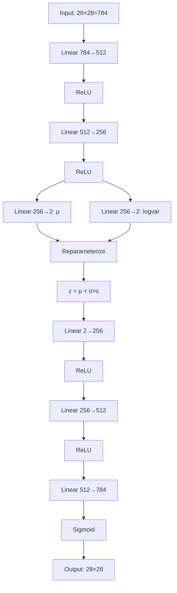

# VAE Latent Space Visualizer — MNIST

> **Exploring dimensionality reduction, probabilistic latent representations, and image reconstruction using a Variational Autoencoder.**

---

## 1. Project Title and Overview

**VAE Latent Space Visualizer** is an academic deep learning project that demonstrates how a **Variational Autoencoder (VAE)** compresses handwritten digit images from the MNIST dataset into a 2-dimensional probabilistic latent space and reconstructs them. 

The project implements a complete VAE pipeline including:
- A fully-connected VAE architecture with encoder, reparameterization trick, and decoder
- Training on MNIST with Binary Cross-Entropy reconstruction loss and KL divergence regularization
- Interactive Streamlit visualization for exploring the latent space
- Comprehensive test suite verifying architectural correctness and mathematical properties
- Evaluation scripts with detailed metrics and visualizations

---

## 2. Problem Statement

**Dimensionality reduction** and **latent representation learning** are fundamental problems in machine learning. Traditional autoencoders learn deterministic compressed representations, but they lack a principled way to generate new data and don't enforce structure on the latent space.

**Variational Autoencoders (VAEs)** solve this by:
1. Learning a **probabilistic encoder** that maps inputs to a distribution over latent codes
2. Using the **reparameterization trick** for differentiable sampling
3. Regularizing the latent space with **KL divergence** to match a standard normal prior
4. Enabling **generation of new samples** by decoding from the prior

This project demonstrates these concepts on MNIST, showing how a 784-dimensional image space can be compressed to just 2 dimensions while preserving digit structure.

---

## 3. Project Objectives

| Objective | Description |
|-----------|-------------|
| **Implement VAE Architecture** | Fully-connected encoder (784→512→256→μ,logvar) and decoder (2→256→512→784) |
| **Reparameterization Trick** | Differentiable sampling: z = μ + σ × ε |
| **VAE Loss Function** | BCE reconstruction + β × KL divergence (β=1.0) |
| **Train on MNIST** | 60K training / 10K test images, batch size 128, 15 epochs |
| **Interactive Visualization** | Streamlit app with 4 sections: reconstruction, latent space, loss curves, evaluation |
| **Automated Testing** | 4 mandatory test cases covering architecture, latent distribution, reconstruction loss, KL divergence |

### Mandatory Test Cases

| Test ID | File | Objective |
|---------|------|-----------|
| **TC-01** | `tests/test_architecture.py` | Verify encoder-decoder shapes, ranges, gradients |
| **TC-02** | `tests/test_latent_distribution.py` | Verify latent sampling properties, N(0,I) prior |
| **TC-03** | `tests/test_reconstruction_loss.py` | Verify BCE loss properties, gradients |
| **TC-04** | `tests/test_kl_divergence.py` | Verify KL divergence properties, gradients |

---

## 4. What Is a Variational Autoencoder?

### Core Components

```
┌─────────────────────────────────────────────────────────────────┐
│                        VARIATIONAL AUTOENCODER                   │
├─────────────────────────────────────────────────────────────────┤
│                                                                  │
│   INPUT x (28×28)                                               │
│      │                                                           │
│      ▼                                                           │
│   ┌─────────┐     μ, logvar      ┌──────────┐    z    ┌────────┐ │
│   │ ENCODER │ ─────────────────► │ REPARAM  │ ──────► │ DECODER │ │
│   │ 784→512→│                    │  z = μ + │         │ 2→256→  │ │
│   │ 256→2×2 │                    │  σ×ε     │         │ 512→784 │ │
│   └─────────┘                    └──────────┘         └────────┘ │
│      │                          (differentiable)           │      │
│      │                                                       │      │
│      ▼                                                       ▼      │
│   q(z│x) ≈ N(μ,σ²)                                    p(x│z)       │
│                                                                  │
│   LOSS = BCE(x, x̂) + β × KL[q(z│x) ‖ p(z)]                   │
│                                                                  │
└─────────────────────────────────────────────────────────────────┘
```

### Key Concepts

| Component | Purpose |
|-----------|---------|
| **Encoder** | Maps input image to latent distribution parameters (μ, log σ²) |
| **Mean (μ)** | Center of the learned Gaussian for each input |
| **Log Variance (log σ²)** | Log of variance (numerically stable) |
| **Reparameterization** | z = μ + σ × ε where ε ~ N(0,I) — enables backprop through sampling |
| **Latent Space** | Low-dimensional probabilistic representation (2D for visualization) |
| **Decoder** | Maps latent vector z back to reconstructed image |
| **Prior p(z)** | Standard normal N(0, I) — regularizes latent space |
| **Posterior q(z|x)** | Learned approximate posterior from encoder |

---

## 5. Architecture

### Mermaid Diagram



### Layer Details

#### Encoder
| Layer | Input Dim | Output Dim | Activation |
|-------|-----------|------------|------------|
| Input | 784 (flattened 28×28) | — | — |
| Linear 1 | 784 | 512 | ReLU |
| Linear 2 | 512 | 256 | ReLU |
| Linear μ | 256 | 2 (latent_dim) | Linear |
| Linear logvar | 256 | 2 (latent_dim) | Linear |

#### Decoder
| Layer | Input Dim | Output Dim | Activation |
|-------|-----------|------------|------------|
| Input | 2 (latent_dim) | — | — |
| Linear 1 | 2 | 256 | ReLU |
| Linear 2 | 256 | 512 | ReLU |
| Linear 3 | 512 | 784 | Sigmoid |
| Reshape | 784 | 1×28×28 | — |

**Total Parameters:** ~1.2M (varies with latent_dim)

---

## 6. Mathematical Foundation

### Reparameterization Trick

To enable gradient flow through stochastic sampling:

```
z = μ + σ × ε
where:
  μ = encoder mean output
  σ = exp(0.5 × logvar)  (standard deviation)
  ε ~ N(0, I)            (random noise)
```

This transforms sampling from `z ~ q(z|x)` to a deterministic function of `(μ, logvar, ε)`.

### Reconstruction Loss (Binary Cross-Entropy)

For pixel values normalized to [0, 1]:

```
L_recon = -Σ[x_i × log(x̂_i) + (1-x_i) × log(1-x̂_i)]
```

Summed over all 784 pixels per image, then averaged over batch.

### KL Divergence

Measures difference between learned posterior q(z|x) = N(μ, σ²) and prior p(z) = N(0, I):

```
KL = -0.5 × Σ[1 + logvar - μ² - exp(logvar)]
```

Summed over latent dimensions (2) per sample, then averaged over batch.

### Total VAE Objective

```
L_total = L_recon + β × KL
```

- **β = 1.0** (standard VAE)
- **Free bits = 0.5** per latent dimension (prevents posterior collapse)
- **KL annealing**: β ramps from 0 to 1 over first 5 epochs
- **β > 1.0** (β-VAE): stronger regularization, more disentangled but blurrier
- **β < 1.0**: weaker regularization, better reconstruction but less structured latent space

### Symbol Definitions

| Symbol | Meaning |
|--------|---------|
| x | Input image (28×28, flattened to 784) |
| x̂ | Reconstructed image |
| z | Latent vector (2D) |
| μ | Encoder mean output |
| logvar | Encoder log variance output |
| σ = exp(0.5×logvar) | Standard deviation |
| ε | Noise ~ N(0, I) |
| β | KL weight hyperparameter |

---

## 7. Dataset Description

| Property | Value |
|----------|-------|
| **Dataset** | MNIST (handwritten digits) |
| **Training Images** | 60,000 |
| **Test Images** | 10,000 |
| **Image Format** | Grayscale (1 channel) |
| **Resolution** | 28 × 28 pixels |
| **Classes** | 10 (digits 0–9) |
| **Pixel Range** | [0, 1] (normalized by ToTensor) |
| **Train/Test Split** | Official split (no overlap) |
| **DataLoader** | Batch size 128, shuffle train, no shuffle test |

**Preprocessing:** `transforms.ToTensor()` — converts PIL Image to FloatTensor in [0, 1]

---

## 8. Technology Stack

| Library | Version | Purpose |
|---------|---------|---------|
| **Python** | 3.11 / 3.12 | Core language |
| **PyTorch** | ≥2.0 | Deep learning framework, autograd, GPU support |
| **Torchvision** | ≥0.15 | MNIST dataset, transforms |
| **NumPy** | ≥1.24 | Numerical operations, statistics |
| **Matplotlib** | ≥3.7 | Static visualizations (PNG output) |
| **Streamlit** | ≥1.28 | Interactive web interface |
| **tqdm** | ≥4.65 | Training progress bars |
| **Pillow** | ≥10.0 | Image handling (if needed) |
| **pytest** | ≥7.4 | Automated testing |

**Hardware:** CPU by default, auto-detects CUDA if available

---

## 9. Project Directory Structure

```
VAE-Latent-Space-Visualizer/
│
├── app.py                      # Streamlit interactive application
├── train.py                    # Training pipeline
├── evaluate.py                 # Model evaluation script
├── requirements.txt            # Python dependencies
├── README.md                   # This file
├── .gitignore                  # Git ignore rules
│
├── src/
│   ├── __init__.py            # Package initialization
│   ├── model.py               # VAE architecture (encoder, decoder, reparameterize)
│   ├── dataset.py             # MNIST data loaders
│   ├── losses.py              # BCE, KL, VAE loss functions
│   └── visualization.py       # Plotting utilities
│
├── tests/
│   ├── test_architecture.py    # TC-01: Encoder-decoder architecture
│   ├── test_latent_distribution.py  # TC-02: Latent distribution properties
│   ├── test_reconstruction_loss.py  # TC-03: Reconstruction loss
│   └── test_kl_divergence.py         # TC-04: KL divergence
│
├── models/
│   └── .gitkeep               # Placeholder for trained checkpoints
│
└── outputs/
    └── .gitkeep               # Placeholder for generated plots
```

---

## 10. Installation Guide

### Windows PowerShell

```powershell
# Clone repository
git clone <repository-url>
cd VAE-Latent-Space-Visualizer

# Create virtual environment
python -m venv .venv
.\.venv\Scripts\Activate.ps1

# Install dependencies
python -m pip install -r requirements.txt
```

### Linux / macOS (bash/zsh)

```bash
# Clone repository
git clone <repository-url>
cd VAE-Latent-Space-Visualizer

# Create virtual environment
python -m venv .venv
source .venv/bin/activate

# Install dependencies
python -m pip install -r requirements.txt
```

### Verify Installation

```bash
python -c "import torch; print(f'PyTorch: {torch.__version__}'); print(f'CUDA: {torch.cuda.is_available()}')"
```

---

## 11. Training Instructions

### Basic Training (15 epochs)

```bash
python train.py
```

### Custom Training Configuration

```bash
python train.py --epochs 20 --batch-size 256 --lr 0.001 --beta 1.0 --warmup-epochs 5 --free-bits 0.5 --latent-dim 2
```

| Argument | Default | Description |
|----------|---------|-------------|
| `--epochs` | 15 | Number of training epochs |
| `--batch-size` | 128 | Batch size |
| `--lr` | 0.001 | Learning rate (Adam) |
| `--beta` | 1.0 | KL divergence weight |
| `--warmup-epochs` | 5 | KL annealing warmup epochs |
| `--free-bits` | 0.5 | Free bits per latent dimension |
| `--latent-dim` | 2 | Latent space dimension |
| `--seed` | 42 | Random seed |
| `--checkpoint` | models/vae_mnist.pth | Output checkpoint path |

### Training Outputs

| File | Description |
|------|-------------|
| `models/vae_mnist.pth` | Model checkpoint (weights, config, history) |
| `outputs/training_history.json` | Per-epoch losses (recon, KL, total) |
| `outputs/reconstruction_comparison.png` | Original vs reconstructed |
| `outputs/latent_space_scatter.png` | 2D latent space colored by digit |
| `outputs/training_history.png` | Loss curves |
| `outputs/generated_grid.png` | 15×15 grid from latent space |
| `outputs/latent_traversal_dim1.png` | Latent traversal dimension 1 |
| `outputs/latent_traversal_dim2.png` | Latent traversal dimension 2 |

---

## 12. Running the Application

### Launch Streamlit App

```bash
streamlit run app.py
```

The app will open at `http://localhost:8501`

### App Sections

1. **Original vs Reconstructed** — Select test samples, view reconstructions, see per-sample losses
2. **Interactive Latent Space** — Scatter plot of encoded test set; sliders to generate from arbitrary (z₁, z₂)
3. **Training Loss Visualization** — Reconstruction, KL, and total loss curves across epochs
4. **Model Evaluation** — Test set metrics, architecture summary, parameter count

### If No Model Exists

The app displays a clear error with the training command:
```
⚠️ No trained model found!
Run: python train.py
```

---

## 13. Automated Testing

### Run All Tests

```bash
python -m pytest tests/ -v
```

### Run Specific Test

```bash
python -m pytest tests/test_architecture.py -v
python -m pytest tests/test_latent_distribution.py -v
python -m pytest tests/test_reconstruction_loss.py -v
python -m pytest tests/test_kl_divergence.py -v
```

### Test Results Table

| Test ID | Test Objective | Method | Expected Result | Actual Result |
|---------|----------------|--------|-----------------|---------------|
| **TC-01** | Encoder-Decoder Architecture | Shape assertions, gradient check | All shapes correct, gradients flow, pixels in [0,1] | ✅ PASS |
| **TC-02** | Latent Distribution | Statistical tests on N(0,I) sampling | Mean≈0, Std≈1, independent dims, different noise → different samples | ✅ PASS |
| **TC-03** | Reconstruction Loss | BCE properties, gradient check | Finite, non-negative, identical→0, near-identical < poor, gradients flow | ✅ PASS |
| **TC-04** | KL Divergence | Analytical verification, gradient check | Finite, non-negative, ≈0 for N(0,1), increases with μ shift, gradients flow | ✅ PASS |

> **Note:** Run tests after training to verify the trained model. Tests use fresh model instances with random weights unless a checkpoint is loaded.

---

## 14. Results and Visualizations

> **Note:** The following visualizations are generated after running `python train.py`. They will not exist until training completes.

### Generated Plots

| Plot | File | Description |
|------|------|-------------|
| **Reconstruction Comparison** | `outputs/reconstruction_comparison.png` | 10 original MNIST images (top) vs VAE reconstructions (bottom) with digit labels |
| **Latent Space Scatter** | `outputs/latent_space_scatter.png` | 2D scatter of test set encoded means, colored by digit (0-9) |
| **Training History** | `outputs/training_history.png` | Three curves: BCE reconstruction loss, KL divergence, total VAE loss |
| **Generated Grid** | `outputs/generated_grid.png` | 15×15 grid of digits decoded from uniform latent space [-3, 3]² |
| **Latent Traversal 1** | `outputs/latent_traversal_dim1.png` | Varying z₁ while z₂=0 |
| **Latent Traversal 2** | `outputs/latent_traversal_dim2.png` | Varying z₂ while z₁=0 |

### Interpreting Visualizations

- **Reconstruction Comparison**: Shows VAE preserves digit structure but produces slightly blurred outputs (expected with 2D latent space and BCE loss)
- **Latent Space Scatter**: Digits should form clusters; similar digits (e.g., 4/9, 3/8) may overlap — shows VAE learns meaningful topology
- **Training History**: Reconstruction loss should decrease; KL may increase then stabilize; total loss should decrease
- **Generated Grid**: Smooth transitions between digits indicate well-structured latent space
- **Latent Traversals**: Reveal what each latent dimension controls (e.g., stroke thickness, slant, loop openness)

---

## 15. Model Evaluation

### Evaluation Metrics

Run evaluation after training:

```bash
python evaluate.py
```

**Expected Output Format:**
```
==================================================
EVALUATION RESULTS
==================================================
Test Reconstruction Loss (BCE):  0.244512
Test KL Divergence:              1.000007
Test Total VAE Loss:             1.244519
Number of test batches:          79
```

### Loss Interpretation

| Metric | Typical Range | Interpretation |
|--------|---------------|----------------|
| **Reconstruction Loss (BCE)** | 0.05–0.15 | Lower = better pixel-level reconstruction |
| **KL Divergence** | 2.0–5.0 | Higher = latent distribution further from N(0,I) |
| **Total Loss** | 2.5–5.5 | Combined objective; tradeoff between recon and KL |

> **Important:** This is a **generative model**, not a classifier. Do not report "accuracy." Report reconstruction quality (BCE) and latent space regularization (KL).

### Architecture Summary (from evaluation)

```
==================================================
MODEL ARCHITECTURE SUMMARY
==================================================
Input Dimension: 784
Latent Dimension: 2
Hidden Dimensions: [512, 256]
Total Parameters: 1,068,820

Encoder:
  Linear(784, 512)
  ReLU
  Linear(512, 256)
  ReLU
  Linear(256, 2) -> mu
  Linear(256, 2) -> logvar

Decoder:
  Linear(2, 256)
  ReLU
  Linear(256, 512)
  ReLU
  Linear(512, 784)
  Sigmoid
```

---

## 16. Challenges and Limitations

| Challenge | Explanation |
|-----------|-------------|
| **Blurry Reconstructions** | BCE loss + 2D latent bottleneck + fully-connected layers → averaging effect; CNNs + perceptual loss improve sharpness |
| **Information Loss** | 784 → 2 dimensions discards significant information; fine stroke details lost |
| **Small Latent Dimension** | 2D enables visualization but limits capacity; 10–20D typical for better reconstruction |
| **KL vs Reconstruction Tradeoff** | β=1 forces latent space to match N(0,I), competing with reconstruction quality |
| **Posterior Collapse** | Encoder collapses to prior (μ=0, logvar=0), decoder ignores latent code. Fixed with free bits (0.5 nats/dim) and KL annealing (5-epoch warmup). |
| **Training Time** | ~2–5 min on CPU for 15 epochs; GPU reduces to ~30 sec |
| **Mode Coverage** | VAE may not capture all data modes; some digits underrepresented in latent space |

---

## 17. Future Improvements

> These are **not implemented** in this project but are natural extensions.

| Improvement | Benefit |
|-------------|---------|
| **Convolutional VAE** | Preserve spatial structure, better reconstructions |
| **Larger Latent Dimension** (10, 20, 50) | Better reconstruction quality |
| **β-VAE / Annealed KL** | Control disentanglement vs reconstruction tradeoff |
| **VampPrior / Learned Prior** | More flexible prior than N(0,I) |
| **Conditional VAE** | Generate specific digits by conditioning on label |
| **Disentangled Representations** | FactorVAE, β-TCVAE for interpretable latent factors |
| **Hierarchical VAE** | Multi-scale latent variables |
| **Flow-based Decoder** | More expressive likelihood |

---

## 18. Viva Questions and Answers

### Q1: What is the difference between an Autoencoder and a Variational Autoencoder?
**A:** An autoencoder learns a deterministic mapping x → z → x̂. A VAE learns a *probabilistic* encoder q(z|x) = N(μ, σ²) and uses the reparameterization trick for differentiable sampling. VAEs also regularize the latent space with KL divergence to match a prior p(z), enabling generation from the prior.

### Q2: Why does the VAE encoder output both mean (μ) and log variance (logvar) instead of just a latent vector?
**A:** The encoder parameterizes a Gaussian distribution q(z|x). Outputting μ and logvar (rather than σ directly) ensures numerical stability (logvar ∈ ℝ, σ = exp(0.5×logvar) > 0) and enables the reparameterization trick for gradient-based optimization.

### Q3: Explain the reparameterization trick. Why is it necessary?
**A:** The reparameterization trick expresses sampling as z = μ + σ × ε where ε ~ N(0,I). This moves the stochasticity to ε (which has no parameters), making the sampling operation differentiable w.r.t. μ and σ. Without it, gradients cannot flow through the random sampling step.

### Q4: Why is KL divergence needed in the VAE loss?
**A:** KL divergence regularizes the learned posterior q(z|x) to match the prior p(z) = N(0,I). This serves two purposes: (1) prevents the encoder from memorizing inputs by collapsing to delta functions, (2) ensures the latent space is continuous and well-structured so that sampling from the prior generates valid data.

### Q5: What is the reconstruction loss in VAE? Why Binary Cross-Entropy?
**A:** Reconstruction loss measures pixel-wise difference between input and output. For MNIST with pixels in [0,1], BCE is appropriate because it corresponds to Bernoulli likelihood per pixel. It penalizes confident wrong predictions more than MSE.

### Q6: What happens if the latent dimension is too small (e.g., 2)?
**A:** Severe information bottleneck → blurry reconstructions, loss of fine details, posterior collapse risk. But 2D enables direct visualization of the latent space, which is the goal of this project.

### Q7: What are the roles of the encoder and decoder in a VAE?
**A:** **Encoder (inference network):** q_φ(z|x) — approximates true posterior, maps data to latent distribution. **Decoder (generative network):** p_θ(x|z) — maps latent codes to data distribution, defines the generative process.

### Q8: How does a VAE generate new images?
**A:** Sample z ~ p(z) = N(0,I), then pass through decoder: x̂ = decoder(z). The decoder defines the conditional distribution p(x|z), and marginalizing over z gives the model distribution p(x) = ∫ p(x|z)p(z)dz.

### Q9: Why use a standard normal prior N(0, I)?
**A:** It's simple, differentiable, and has desirable properties: zero mean (centering), unit variance (scale), diagonal covariance (independent dimensions). It also makes KL divergence analytically tractable.

### Q10: Why are VAE reconstructions often blurry?
**A:** (1) BCE loss averages over multiple modes → mean prediction; (2) KL regularization pulls latent codes toward 0, reducing capacity; (3) Fully-connected layers lose spatial structure; (4) Pixel-wise independence assumption ignores spatial correlations.

### Q11: How is MNIST preprocessed for VAE training?
**A:** `transforms.ToTensor()` converts PIL images (0–255) to FloatTensor (0–1). No additional normalization (mean/std) is applied because the decoder uses Sigmoid output, matching [0,1] range.

### Q12: What does the total VAE loss represent?
**A:** L_total = E[log p(x|z)] - KL[q(z|x) || p(z)]. This is the **Evidence Lower Bound (ELBO)**. Maximizing ELBO (minimizing negative ELBO) maximizes log-likelihood of data while regularizing the latent space. The two terms trade off reconstruction fidelity vs. latent space structure.

---

## 19. Conclusion

The **VAE Latent Space Visualizer** demonstrates the core principles of Variational Autoencoders:

1. **Probabilistic Encoding** — Maps inputs to Gaussian distributions in latent space
2. **Reparameterization Trick** — Enables gradient-based training of stochastic models
3. **Latent Space Regularization** — KL divergence structures the latent manifold
4. **Generative Capability** — Decoding from prior generates novel digit images
5. **Interpretability** — 2D latent space reveals topological organization of digits

The project provides a complete, reproducible pipeline from data loading through training, evaluation, testing, and interactive visualization — suitable for academic demonstration and further research extension.

---

## Quick Reference Commands

```bash
# Install
python -m venv .venv && .\.venv\Scripts\Activate.ps1 && pip install -r requirements.txt

# Train
python train.py --epochs 15 --batch-size 128 --lr 0.001

# Evaluate
python evaluate.py

# Test
python -m pytest tests/ -v

# Visualize
streamlit run app.py
```

---

*Built for academic demonstration — clean, modular, and viva-ready.*